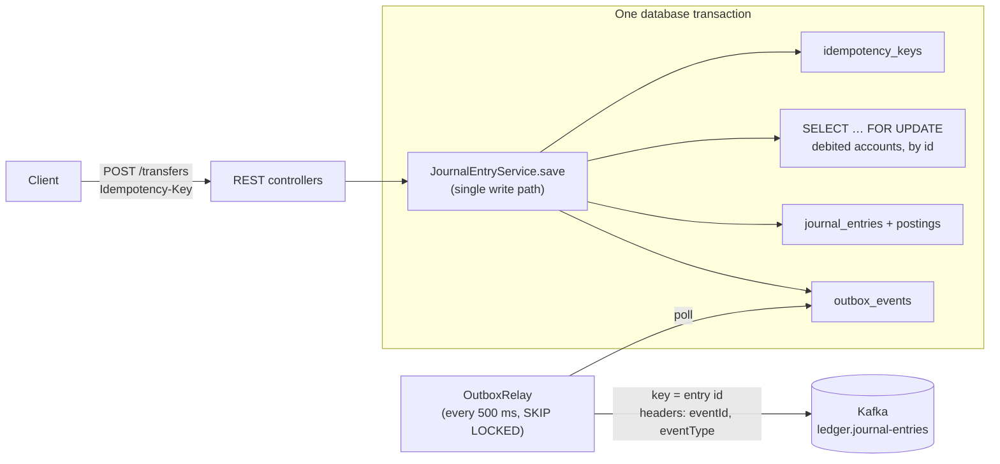

# ledger-service

[](https://github.com/davidmasdev/ledger-service/actions/workflows/ci.yml)

A double-entry ledger REST API for payments. It's built to stay correct under concurrent requests: no double-spending,
no duplicate postings on retries, and no lost or phantom events.

**Java 25 · Spring Boot 4.1 · PostgreSQL 17 · Kafka · Flyway · Testcontainers · k6**

**Sustains 500 transfers/s** with 0 errors and p95 < 35 ms ([load test results](load-test/RESULTS.md)).

## What it guarantees

| Guarantee | How |
|---|---|
| Every journal entry balances: ≥ 2 postings summing to zero **per currency** | Domain model (`JournalEntry.create`), unit-tested |
| History is never rewritten; corrections are reversal entries | Hibernate `@Immutable` entities **and** database triggers that reject `UPDATE`/`DELETE`/`TRUNCATE` ([ADR 0001](docs/adr/0001-enforce-ledger-invariants-in-the-database.md)) |
| A posting's currency matches its account's | Service check **and** a composite foreign key `(account_id, currency)` |
| No double-spending: protected accounts never go negative | Debited accounts are row-locked in ascending id order before the balance check ([ADR 0003](docs/adr/0003-pessimistic-locking-for-balance-checks.md)) |
| Retries are safe: a replayed request returns the original response | `Idempotency-Key`; the key is inserted first, in the same transaction ([ADR 0002](docs/adr/0002-idempotency-keys.md)) |
| Every entry is published to Kafka, exactly when it commits | Transactional outbox and a polling relay, at-least-once delivery ([ADR 0004](docs/adr/0004-transactional-outbox-with-polling-relay.md)) |

Money is `BigDecimal` with an explicit ISO 4217 currency. On the wire, amounts are strings formatted to the
currency's minor units (`"10.00"`, `"500"` for JPY), so clients never parse them as floating point.

## Architecture



Every write (a journal entry, a reversal or a transfer) goes through `JournalEntryService.save`, in one transaction:

1. Record the idempotency key, or return the original result if the key was already used.
2. Validate the entry (balanced per currency, accounts exist, currencies match).
3. Lock the protected accounts that lose money, in ascending id order, and check their balances.
4. Insert the entry, its postings and an outbox event.

Kafka is only ever called by `OutboxRelay`, after the commit.

The code is packaged by feature: `account`, `journal`, `transfer`, `idempotency`, `outbox`, and `shared` (money and
errors).

## API

| Method | Path | Description |
|---|---|---|
| `POST` | `/accounts` | Open an account: `{name, currency, allowNegative?}` |
| `GET` | `/accounts/{id}` | Account with its balance (derived from postings) |
| `POST` | `/journal-entries` | Post a balanced entry. Requires `Idempotency-Key`. |
| `GET` | `/journal-entries/{id}` | Entry with its postings and `kind` (`ENTRY` / `REVERSAL` / `TRANSFER`) |
| `POST` | `/journal-entries/{id}/reversal` | Reverse an entry, at most once. Requires `Idempotency-Key`. |
| `POST` | `/transfers` | Move money: `{fromAccountId, toAccountId, currency, amount}`. Requires `Idempotency-Key`. |

Errors use [RFC 9457 Problem Details](https://www.rfc-editor.org/rfc/rfc9457):

| Status | Meaning |
|---|---|
| 400 | Invalid input or missing `Idempotency-Key` |
| 404 | Unknown resource |
| 409 | Already reversed, or a duplicate name |
| 422 | Ledger rule broken: unbalanced entry, insufficient funds, currency mismatch, or a key reused for a different request |

<details>
<summary>Example: fund an account, then transfer</summary>

```bash
# A funding account may go negative; customer accounts may not (the default).
curl -s -X POST localhost:8080/accounts -H 'Content-Type: application/json' \
  -d '{"name": "funding", "currency": "USD", "allowNegative": true}'          # → id 1
curl -s -X POST localhost:8080/accounts -H 'Content-Type: application/json' \
  -d '{"name": "alice", "currency": "USD"}'                                   # → id 2
curl -s -X POST localhost:8080/accounts -H 'Content-Type: application/json' \
  -d '{"name": "bob", "currency": "USD"}'                                     # → id 3

curl -s -X POST localhost:8080/journal-entries -H 'Content-Type: application/json' \
  -H 'Idempotency-Key: deposit-1' \
  -d '{"description": "deposit", "postings": [
        {"accountId": 1, "currency": "USD", "amount": "-50.00"},
        {"accountId": 2, "currency": "USD", "amount": "50.00"}]}'

curl -s -X POST localhost:8080/transfers -H 'Content-Type: application/json' \
  -H 'Idempotency-Key: transfer-1' \
  -d '{"fromAccountId": 2, "toAccountId": 3, "currency": "USD", "amount": "60.00"}'
# → 422 {"detail": "Insufficient funds in account 2", ...}
```
</details>

## Running it

You need Java 25 and Docker.

```bash
./mvnw verify            # build + all tests (Testcontainers starts PostgreSQL and Kafka)
./mvnw spring-boot:run   # run on :8080; PostgreSQL and Kafka start from compose.yaml (Kafka uses host port 9092)
```

The database schema is managed only by Flyway (`src/main/resources/db/migration`). Hibernate just validates it.

## Testing

67 tests, all run by CI on every push and pull request:

- **Concurrency.** 20 simultaneous transfers of 10.00 from an account holding 100.00: exactly 10 succeed and 10 are
  rejected, and the final balance is 0.00. A second test runs entries that debit the same accounts in opposite
  orders, and none of them deadlock. A third sends 8 simultaneous requests with one idempotency key, and exactly one
  entry is posted.
- **Database guarantees**, tested with plain SQL that bypasses JPA: the append-only triggers and the currency
  foreign key.
- **Outbox, end to end:** a transfer reaches a real Kafka broker. Another test shows that a failed send leaves events
  pending until a retry succeeds.
- API tests for every endpoint and error case, and unit tests for the double-entry rules.

**Load test:** [k6](load-test/README.md), open model. **500 transfers/s sustained** across two runs (0 errors, p95
19–32 ms). Throughput from a single hot account is capped at about 120/s by its row lock, by design. Method, tables and
findings: [load-test/RESULTS.md](load-test/RESULTS.md).

## Design decisions

| ADR | Decision |
|---|---|
| [0001](docs/adr/0001-enforce-ledger-invariants-in-the-database.md) | Enforce the ledger rules in the database, not only in the domain model |
| [0002](docs/adr/0002-idempotency-keys.md) | Idempotency keys: insert the key first; rebuild the response on replay |
| [0003](docs/adr/0003-pessimistic-locking-for-balance-checks.md) | Pessimistic row locks for balance checks, rather than optimistic locking or `SERIALIZABLE` |
| [0004](docs/adr/0004-transactional-outbox-with-polling-relay.md) | Transactional outbox with a polling relay, rather than Debezium |

## What I'd do next

- **A stored balance column**, updated under the existing lock. It would make the balance check constant-time and
  raise the ~120/s single-account limit.
- **Faster outbox relaying**, with larger batches or several relay threads. The lag reached 17 s at 500/s.
- **Cleanup of published outbox rows**, and per-client scoping and expiry for idempotency keys.

## License

[MIT](LICENSE)
